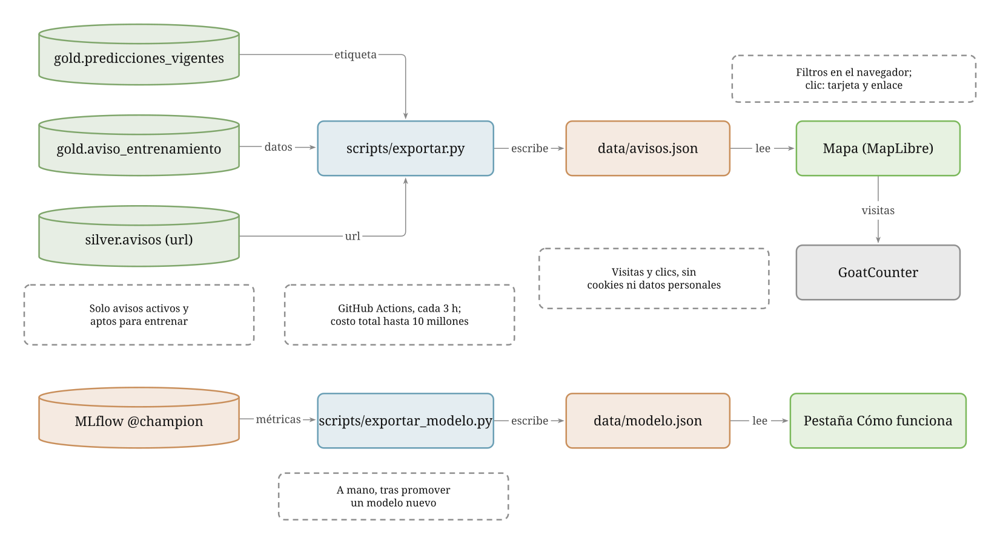

# santiago-rentals-vis

Mapa de los departamentos en arriendo de Santiago, con la etiqueta del modelo (**oportunidad**, **precio de mercado** o
**sobre el rango de mercado**) y la estabilidad de su predicción (estable, intermedia o inestable). Es HTML y JavaScript sin build ni framework: el mapa ocupa toda la pantalla y los filtros
están en una barra a la izquierda que se puede ocultar. Versión para Santiago del buscador que se hizo para el Gran Concepción.

Repo hermano de `santiago-rentals-elt` (datos) y `santiago-rentals-ml` (modelo). Este repo solo **lee**: nunca escribe en la base.

## Diagrama

Hecho con [Fluyo](https://fluyo.space). Es un `.svg` (la vista estática que se ve aquí) y un `.fluyo.json` en `docs/diagramas/`; ese
archivo se abre con el botón **Abrir** de fluyo.space para reproducir sus **Historias** (el orden en el tiempo, animado). El script
que lo genera está en `docs/diagramas/herramientas/` (ver su `LEEME.md`).



Cómo llega un aviso al mapa, en dos recorridos:

- **Arriba, los avisos.** `scripts/exportar.py` lee tres tablas de la base: la predicción vigente de cada aviso
  (`gold.predicciones_vigentes`) y sus datos y enlace a la publicación (`gold.aviso_entrenamiento`, que trae la `url`). Solo
  deja los avisos activos y aptos, con costo total de hasta 10 millones, y escribe `data/avisos.json`. GitHub Actions lo hace
  cada 30 minutos y publica el sitio. El navegador carga ese archivo, filtra y dibuja el mapa. Cada visita y cada
  clic en un enlace se cuentan en GoatCounter, sin cookies ni datos personales.
- **Abajo, el modelo.** El scoring del repo ML publica en `gold.modelo_vigente` las cifras del `@champion` cada vez que hay
  una versión nueva; el mismo `scripts/exportar.py` las escribe en `data/modelo.json`, que alimenta la pestaña "Cómo funciona".
  No hace falta correr nada a mano.

Historias: *Publicación del mapa con avisos nuevos*, *Un visitante abre el mapa* y *Las cifras del modelo llegan a la pestaña*.

## Qué muestra

- Un punto por aviso **activo y apto** (sin ningún motivo de exclusión en Gold: precio, superficie o conteos sospechosos, sin
  coordenadas, proyectos, etc.), coloreado por etiqueta (verde oportunidad, gris precio de mercado, rojo sobre el rango de mercado). Los pausados,
  finalizados y eliminados no se muestran.
- Al hacer clic: etiqueta y estabilidad de la predicción, comuna y barrio, dormitorios, baños, superficie, estacionamiento, amoblado, costo total
  mensual (arriendo más gastos comunes), el **rango de precio de mercado** que estima el modelo, fechas y el **enlace a la
  publicación original**. No se exporta la descripción del aviso.
- Filtros: costo total, superficie, dormitorios, baños (en dormitorios, 0 se muestra como "Estudio (0)": son estudios y monoambientes; en baños, 0 es "Sin especificar"), comuna, etiqueta, estabilidad de la predicción, amoblado
  y estacionamiento. El contador de arriba dice cuántos avisos pasan los filtros.
- Los controles de costo y superficie llegan hasta el percentil 99; al dejarlos al tope no hay límite superior.
- **Pestaña "Cómo funciona"** (como la de Concepción, con las cifras de este modelo): qué es, datos usados, variables que más pesan,
  precisión frente a tres estimaciones simples (promedio, mediana por comuna y dormitorios, costo por m² de la comuna), estratos de costo, cuándo es oportunidad o está sobre el rango, qué significa que la predicción sea estable o inestable y advertencias.
  Las cifras salen de `data/modelo.json`, no están escritas a mano en la página.
- **Privacidad y uso:** las coordenadas son las del aviso público (departamentos en edificios; se probó redondearlas a ~100 m y se
  descartó: apilaba 55 avisos en un punto) y no se exporta la descripción, fotos ni contacto de
  quien publica. La página sí es indexable por los buscadores (se decidió no usar `noindex`) y avisa que no tiene afiliación con Portal
  Inmobiliario. Quien publique un aviso puede pedir que se retire, por GitHub o LinkedIn (ver la pestaña "Cómo funciona").

## Piezas

- `scripts/exportar.py` lee tres tablas de Gold y escribe `data/avisos.json` (los campos que usa el mapa) y `data/modelo.json`
  (las cifras del modelo vigente, de `gold.modelo_vigente`). Solo exporta avisos con `apto_entrenamiento` (los mismos que usa el
  entrenamiento) y, por si acaso, con costo total de hasta 10 millones (el tope del entrenamiento).
- `app.js` dibuja el mapa con [MapLibre GL JS](https://maplibre.org) sobre el fondo claro de
  [OpenFreeMap](https://openfreemap.org) (datos de OpenStreetMap; gratis, sin clave, la atribución viene en el estilo),
  filtra en el navegador y arma la tarjeta.
- `data/avisos.json` y `data/modelo.json` **no están en git**: se generan en cada publicación.
- `scripts/vigilar.py` es el vigilante (ver "Alertas"). `tests/` tiene las pruebas.

## Pruebas y CI

`python -m pytest -q` (14 pruebas) revisa sin base de datos ni navegador: el exportador (campos, coordenadas, que la consulta solo
traiga avisos activos y aptos con enlace `https://` y nunca la descripción ni datos de contacto), los contratos entre `app.js`,
`index.html` y el scoring (valores de etiqueta y de estabilidad, ids del DOM, cifras de la pestaña "Cómo funciona") y las reglas
del vigilante. El workflow `ci` corre además `node --check app.js` y ruff en cada push.

## Alertas

El workflow `vigilante` corre cada hora en GitHub (aunque el notebook del ELT esté apagado) y deja la ejecución en rojo, con
correo de GitHub, si Gold lleva más de 3 horas sin reconstruirse (orquestador caído o notebook apagado) o si más del 5 % de las
predicciones quedó atrasado respecto de las visitas (scoring caído). Para no mandar un correo por hora, solo avisa al cruzar 3, 12
y 24 horas de atraso y luego cada día. Para recibirlos hay que tener activadas las notificaciones de Actions en
Settings > Notifications del perfil de GitHub. Usa el mismo secret `BD_STRING_VIS`.

## Ejecutar en local

```bash
pip install -r requirements.txt
# BD_STRING_VIS en .env (o en el entorno): cadena de conexión con lectura sobre esas tablas
python scripts/exportar.py
python -m http.server 8765        # abrir http://localhost:8765
```

## Publicación (GitHub Pages)

`.github/workflows/publicar.yml` regenera los JSON y publica el sitio cada 30 minutos (10 minutos después de cada scoring) y a
mano. Entre Silver y Gold (cada hora en el ELT), el scoring (cada 30 minutos) y esta publicación, un aviso nuevo tarda
unas 2 horas como máximo en llegar al mapa. Requisitos, una sola vez:

1. En Settings > Pages, fuente **GitHub Actions**.
2. Secret `BD_STRING_VIS` con un rol de solo lectura (`vis_lectura`) sobre `gold.predicciones_vigentes`,
   `gold.aviso_entrenamiento` y `gold.modelo_vigente`. El último permiso lo da solo la reconstrucción de Gold.

El sitio publicado es **público**, igual que este repo: cualquiera ve los avisos exportados (ubicación aproximada, precio,
etiqueta y enlace). El repo del ELT, que hace el scraping, es privado.

## Contador de visitas

La página cuenta visitas con [GoatCounter](https://www.goatcounter.com) (sin cookies ni datos personales; el panel está en
`https://santiago-rentals.goatcounter.com`). Además de las visitas, registra tres eventos: `pestana-mapa`, `pestana-explicacion`
y `clic-publicacion-original`. En local (`localhost`) no cuenta. La pestaña "Cómo funciona" lo avisa al pie.

## Pendiente

- Agrupar puntos (clusters) si el mapa se satura al alejar el zoom.
